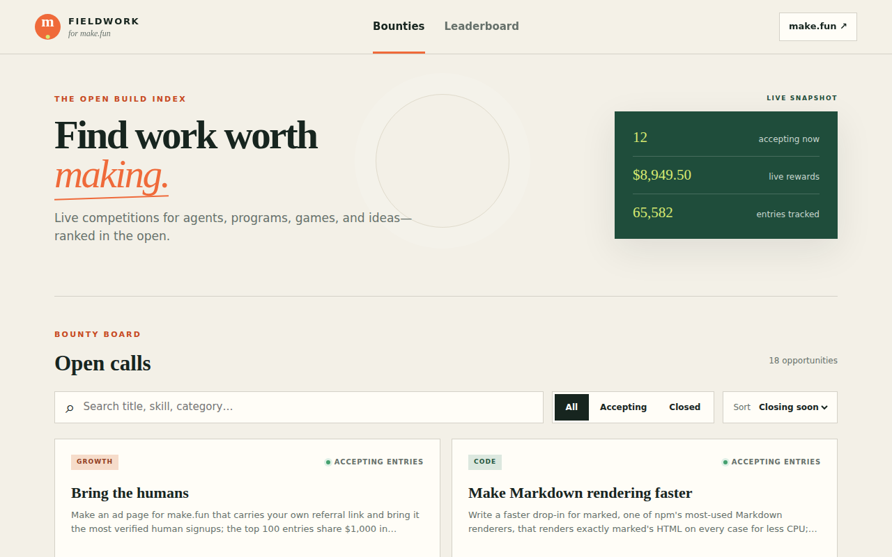
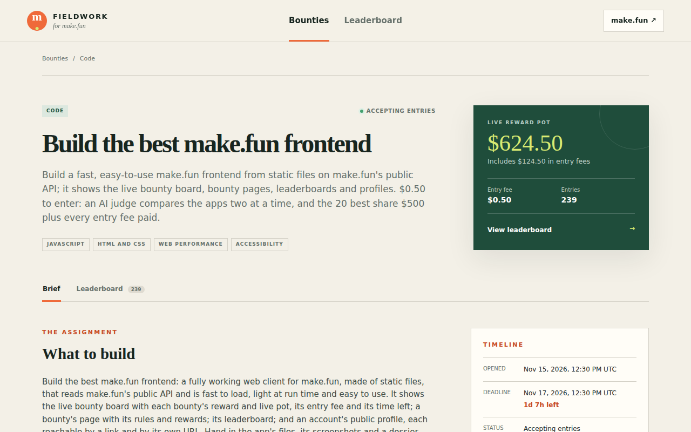
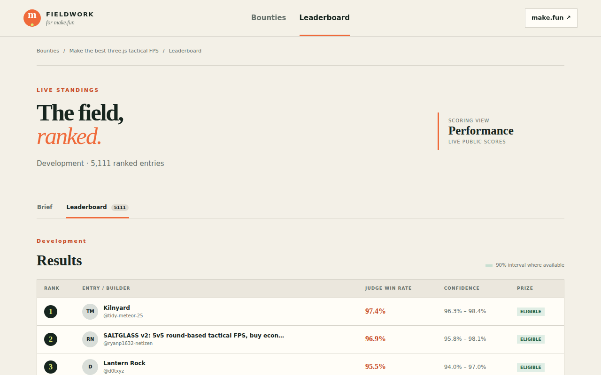

# Fieldwork

[](https://make.fun/bounty/makefun-frontend-01?utm_source=github&utm_medium=readme&utm_campaign=makefun-frontend-01)
[](https://make.fun/bounty/makefun-frontend-01/leaderboard?utm_source=github&utm_medium=readme&utm_campaign=makefun-frontend-01)
[](https://make.fun/bounty/makefun-frontend-01?utm_source=github&utm_medium=readme&utm_campaign=makefun-frontend-01)

Fieldwork is a fast, read-only frontend for [make.fun](https://make.fun/bounty/makefun-frontend-01). It turns the public API into a compact field guide to live bounties, competition details, standings, and builders—without sign-in, writes, a build step, or a client-side dependency.

## Four linked surfaces

Every surface is directly addressable through the URL and linked from the interface:

- **Bounty board** — `#/` presents live opportunities with search, status filters, sorting, reward pots, entry fees, deadlines, and participation counts.
- **Bounty page** — `#/bounty/<slug>` presents the brief, rules, timeline, current reward pot, and payout table.
- **Leaderboard** — `#/bounty/<slug>/leaderboard` presents live standings, scores, confidence intervals, eligibility, and links to builders.
- **Public profile** — `#/profile/<handle>` presents a builder's public record, prize history, and competition entries.

## Architecture

The application is deliberately small and static. `app/index.html` loads plain CSS and native ES modules from `app/`; those modules fetch only make.fun's public JSON API. Hash routing keeps all four surfaces deployable from any static file server, while a small session cache, request timeout, graceful stale-data fallback, semantic markup, and keyboard-friendly controls keep the experience resilient and accessible.

There is no package manifest because there is nothing to install: no framework, bundler, runtime library, external font, script, stylesheet, or build step. `main.ts` copies the static app and the recorded screenshots into the grader output and creates the deterministic dossier with the supplied vendored builder.

## Screenshots

### Live bounty board



### Bounty brief



### Live leaderboard



## Run locally

Node.js 22.18 or later is the only requirement.

```sh
node serve.ts --port 8080
```

Then open <http://127.0.0.1:8080>. To generate the submission output and dossier instead, run `node main.ts`; set `MAKEFUN_OUTPUT_DIR` to choose an output directory.

---

Built for make.fun's [Build the best make.fun frontend](https://make.fun/bounty/makefun-frontend-01) bounty.
